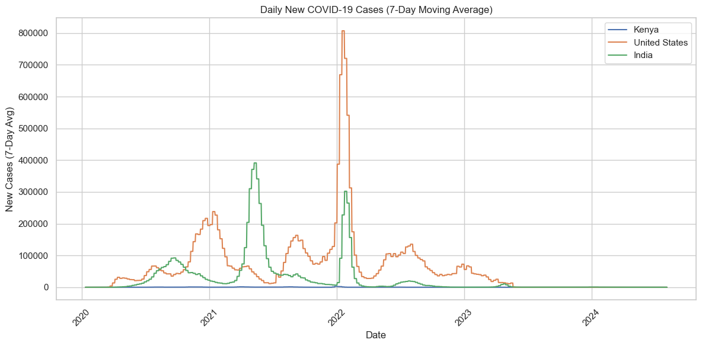
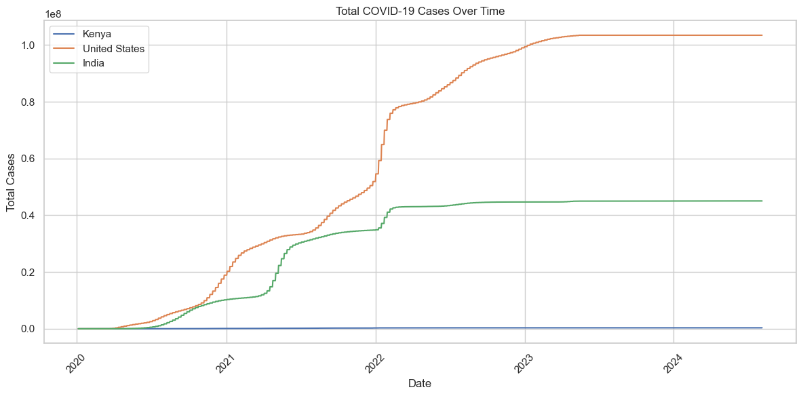

# COVID-19 Data Tracker

A Jupyter notebook that compares the course of COVID-19 in Kenya, the
United States and India: cases, deaths, death rates and vaccinations, using
the Our World in Data (OWID) dataset.



## What it found

From the OWID data, which runs to mid-2024:

| Country | Total cases | Total deaths | Deaths per case |
|---|---|---|---|
| United States | 103.4 million | 1,193,165 | 1.15% |
| India | 45.0 million | 533,623 | 1.18% |
| Kenya | 344,106 | 5,689 | 1.65% |

- **The waves differ by country.** India's worst wave peaked in May 2021
  (the Delta wave); the United States peaked in January 2022 (Omicron).
- **Kenya's numbers are far lower,** partly because its population is much
  smaller and likely also because it tested less. Deaths per case is higher
  there, but with less testing fewer mild cases get counted, which pushes
  that ratio up.
- **India reported 67% of its population fully vaccinated** at the last
  date with data.



## What the notebook does

`covid_tracker.ipynb`:

1. **Loads** the OWID file and checks columns and missing values.
2. **Cleans** it: keeps the three countries, drops rows without dates,
   cases or deaths, and converts dates.
3. **Explores** it: total cases and deaths over time, a 7-day moving
   average of new cases, deaths per case at the latest date, and a bar
   chart of total cases.
4. **Vaccinations:** total doses over time and the share of each
   population fully vaccinated.
5. **World maps** (Plotly) of total cases and vaccination rate for every
   country.
6. **Summary numbers:** highest totals and the peak week for new cases.

## How to run it

The data file is too large for this repo, so download it first:

1. Get `owid-covid-data.csv` from the
   [OWID COVID-19 data repository](https://github.com/owid/covid-19-data/tree/master/public/data)
   and put it next to the notebook.
2. Install the packages and open the notebook:

```bash
pip install -r requirements.txt
jupyter notebook covid_tracker.ipynb
```

## Known issues

- **Missing vaccination counts are filled with 0.** On days with no report
  the cumulative total drops to zero and comes back, so the vaccination
  line chart has false dips. The "latest date" vaccination bar also shows
  0% for Kenya and the United States, because neither reported on that
  date. Carrying the last reported value forward for each country would
  fix both.
- **This version of the OWID file reports new cases once a week,** so the
  "peak new cases" figures in the notebook are weekly totals, not single
  days. The 7-day average turns them back into a daily rate.
- Each step reloads the CSV, and pandas warns about setting values on a
  slice. Neither changes the results.

## Author

Tiiso Letsapa, Letsapamyron07@gmail.com
